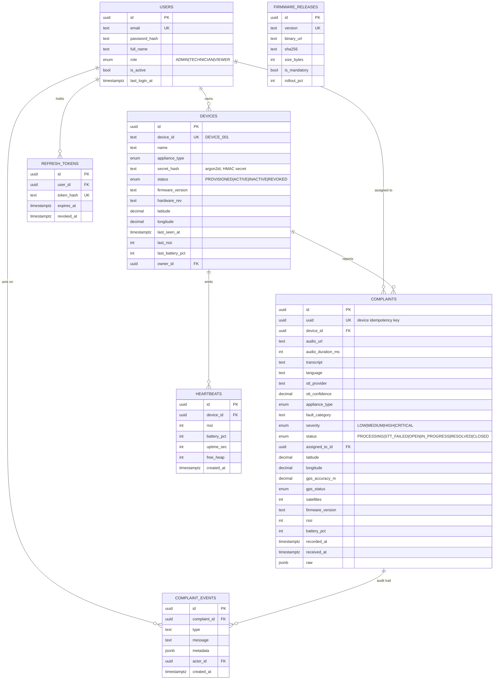

# Entity Relationship Diagram



## Design notes

**Why `complaints.uuid` exists separately from `id`.** The device mints a UUID before it has any
network connection. That value is the idempotency key for retries. `id` is the server's own primary
key so the device can never influence internal identifiers.

**Why `raw jsonb` exists.** Firmware in the field runs versions you no longer control. When v1.4
starts sending a field the schema doesn't have, it lands in `raw` instead of being dropped. Costs
~400 bytes per row and has saved every IoT project I have worked on at least one incident.

**Why appliance type is on both tables.** `devices.appliance_type` is what was provisioned.
`complaints.appliance_type` is what the LLM heard. When they disagree, someone moved the device —
that discrepancy is a useful report.

**Geo queries.** For "complaints within 5 km", enable PostGIS and add a generated column:

```sql
ALTER TABLE complaints
  ADD COLUMN geom geography(Point,4326)
  GENERATED ALWAYS AS (
    CASE WHEN latitude IS NOT NULL AND longitude IS NOT NULL
    THEN ST_SetSRID(ST_MakePoint(longitude::float8, latitude::float8), 4326)::geography END
  ) STORED;
CREATE INDEX complaints_geom_idx ON complaints USING GIST (geom);
```

**Retention.** `heartbeats` grows fastest (one row per device per 5 min ≈ 288/device/day). Add a
partition by month or a 30-day cron delete; the dashboard only ever needs the rollup.
